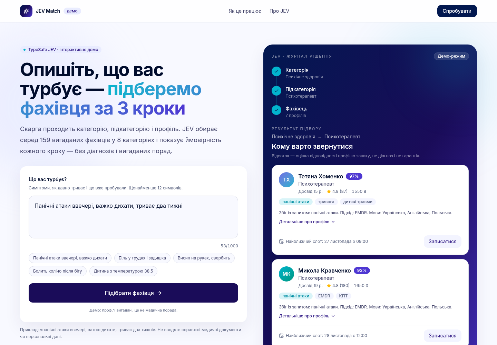
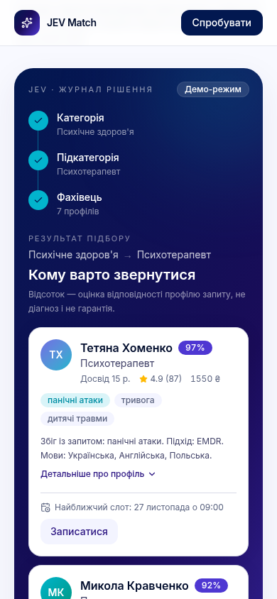
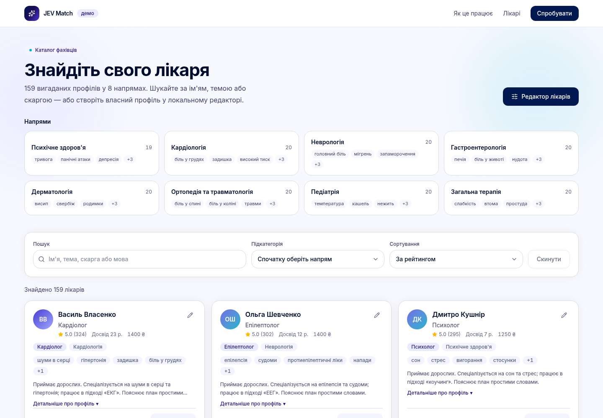
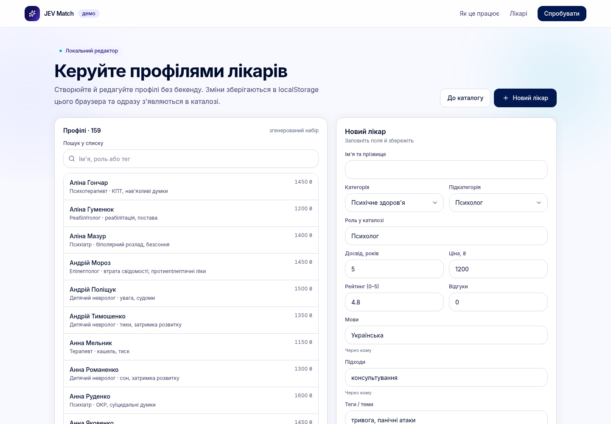

# JEV Match — демо підбору фахівця за 3 кроки

Демонстраційний Next.js-застосунок, який показує, як **TypeSafe JEV** (System One) обирає
спеціаліста зі скарги користувача у три послідовні кроки:

1. **Категорія** — 8 напрямів медицини.
2. **Підкатегорія** — конкретний фах усередині категорії.
3. **Фахівець** — рейтинг 5–8 профілів за ймовірністю відповідності.

Усі категорії, підкатегорії та 159 профілів **згенеровані** — жодної реальної бази даних,
жодних справжніх лікарів. Візуальна мова взята з лендінгу `med-space`: Inter, `#F8F9FF`,
темно-синій `#021850`, фіолетовий `#4E37D2`, ціан `#02B4CD`, радіуси 12/18/27.









## Як працює флоу

```
скарга → POST /api/match {step:"category"}     → категорія + ймовірності + is_emergency
       → POST /api/match {step:"subcategory"}  → підкатегорія + ймовірності
       → POST /api/match {step:"doctors"}      → профілі, відсортовані за ймовірністю
```

Кожен крок — окремий виклик JEV, бо питання в одному запиті незалежні й не бачать відповідей
одне одного. Мінімальна видима тривалість кроку — 350 мс, щоб прогрес не «блимав».

- **Низька впевненість** (`confidence < 0.55` для категорії, `< 0.50` для підкатегорії) —
  показуємо top-3 варіанти з відсотками та ручний вибір.
- **Екстрений випадок** (`is_emergency ≥ 0.60`) — червоне попередження з 103/112 над результатами.
- **JEV недоступний / немає ключа** — детермінований локальний mock із тим самим контрактом;
  у консолі з'являється позначка «Демо-режим» і примітка про fallback.
- **Відображуваний % збігу** нормалізований відносно лідера (55–97%), щоб картки читалися,
  коли ймовірності розподілені між схожими профілями. Сире `probability` лишається в API.

## Голосове введення скарги

Поле «Що вас турбує?» має кнопку **«Надиктувати»**: текст розпізнається українською
(`uk-UA`) через **Web Speech API** браузера. Це не OpenAI Whisper — окремий аудіобекенд і
ключ не потрібні, тому демо працює локально. Розпізнавання доступне у Chrome та Edge;
в інших браузерах кнопка покаже зрозуміле повідомлення. Розпізнаний фрагмент додається до
вже введеного тексту (ліміт 1000 символів), застосунок не зберігає аудіо.

## Каталог лікарів і локальний редактор

- **`/doctors`** — пошук серед 159 профілів: ім'я, тема, скарга, мова, роль. Фільтри за
  напрямом і підкатегорією, сортування за рейтингом/досвідом/ціною. Біля кожного напряму
  видно його теги (наприклад, «тривога», «панічні атаки»), а після вибору напряму теги стають
  клікабельними фільтрами.
- **`/doctors/editor`** — створення, редагування та видалення профілів без бекенду.
  Зміни лежать у `localStorage` під ключем `jev-match:local-doctors:v1`: редаговані згенеровані
  профілі зберігаються як overrides, нові — як `created`. Валідація — та сама Zod-схема
  `SpecialistSchema`, що й для зчитаних даних.
- Редактор **не впливає на підбір JEV**: `/api/match` працює зі згенерованим набором, тож демо
  лишається відтворюваним. Каталог лише накладає локальні зміни поверх базових 159 профілів.

## Стек

Next.js 16.4 (App Router, Turbopack, Cache Components) · React 19 · TypeScript strict ·
Tailwind CSS 4 (CSS-first токени) · Radix UI · lucide-react · Zod 4.

Без React Query, без БД, без авторизації: один клієнтський флоу та один route handler.

## Швидкий старт

```bash
npm install
cp .env.example .env.local   # можна залишити ключ порожнім — працюватиме mock
npm run dev                  # http://localhost:3000
```

Без `OPENROUTER_API_KEY` застосунок автоматично працює в демо-режимі. Для живих відповідей
додайте ключ OpenRouter із доступом до TypeSafe JEV і перезапустіть dev-сервер.

```bash
npm run build && npm start
```

## Змінні середовища

| Змінна | Типове | Призначення |
| --- | --- | --- |
| `OPENROUTER_API_KEY` | — | ключ OpenRouter; лише server-side |
| `JEV_MODEL` | `~typesafe/jev-latest` | модель або пін, напр. `typesafe/jev-1.14` |
| `JEV_DECISIONS_URL` | OpenRouter Decisions API | альтернативний проксі/endpoint |
| `JEV_MODE` | `auto` | `auto` \| `live` \| `mock` |
| `JEV_TIMEOUT_MS` | `12000` | таймаут одного HTTP-запиту |
| `JEV_MAX_RETRIES` | `2` | повтори для 429/529/мережі |
| `JEV_CATEGORY_MIN_CONFIDENCE` | `0.55` | поріг уточнення категорії |
| `JEV_SUBCATEGORY_MIN_CONFIDENCE` | `0.50` | поріг уточнення підкатегорії |
| `JEV_EMERGENCY_THRESHOLD` | `0.60` | поріг банера 103/112 |
| `JEV_RATE_LIMIT_PER_MIN` | `30` | ліміт запитів на IP за хвилину |

Секрети не потрапляють у клієнтський бандл: `OPENROUTER_API_KEY` читається лише в
`src/lib/jev/client.ts`, усі виклики JEV — на сервері.

## Дані

- `src/features/specialists/data/categories.ts` — рукописні 8 категорій × 3 підкатегорії
  з описами, `jevDescription` (текст, який бачить модель) і 6 тегів для каталогу та критеріїв JEV.
- `scripts/generate-specialists.mjs` — детермінований генератор (seed `20261124`):
  вигадані імена, досвід, рейтинг, ціна, теги, підходи, освіта, слоти.
- `src/features/specialists/data/specialists.generated.ts` — 159 профілів, 5–8 на підкатегорію.

Перегенерація: `npm run data:generate`. Файл закомічений, щоб демо було відтворюваним.

## Архітектура

```
src/app/                      маршрути й metadata
  api/match/route.ts          POST: валідація, rate limit, no-store
  page.tsx                    композиція єдиного екрана
  doctors/page.tsx            каталог лікарів
  doctors/editor/page.tsx     локальний редактор (localStorage)
src/features/matching/
  components/                 MatchExperience, MatchForm, DecisionConsole,
                              StepTracker, ClarifyCard, MatchResults, SpecialistCard
  hooks/useMatchFlow.ts       стани idle → running → clarify → done | error
  lib/decide.ts               live/mock рішення, fallback, safety
  lib/questions.ts            побудова choice/noul-питань для JEV
  lib/explanations.ts         збіг тегів і шаблонне пояснення
  schemas/match.ts            Zod-контракт запиту
  types.ts                    контракт відповіді
src/features/doctors/         DoctorDirectory, DoctorCatalogCard, DoctorEditor
src/features/specialists/     типи, категорії, згенеровані профілі, Zod-схема,
                              localStorage-store і хук локальних змін
src/lib/jev/                  config, client (retry/timeout), mock, errors, types
src/components/ui/            Button, Card, Textarea, Badge, Alert, Collapsible
src/components/common/        SiteHeader, SiteFooter, TrustStrip
```

Межа клієнт/сервер: `page.tsx` — Server Component; інтерактивний острів починається з
`MatchExperience`. Route handler не кешується, відповіді мають `Cache-Control: no-store`.

### Контракт API

```jsonc
// POST /api/match
{ "step": "doctors", "complaint": "…", "categoryId": "mental-health", "subcategoryId": "psychotherapist" }

// 200
{
  "step": "doctors",
  "mode": "live",                 // live | mock
  "model": "typesafe/jev-1.14",
  "latencyMs": 812,
  "selected": { "id": "psychotherapist-2", "name": "…", "confidence": 0.71, "source": "jev" },
  "candidates": [{ "id": "…", "name": "…", "description": "…", "probability": 0.71 }],
  "needsClarification": false,
  "doctors": [{ "id": "…", "name": "…", "matchPercent": 97, "probability": 0.71,
                "matchedTags": ["панічні атаки"], "rationale": "…" }],
  "safety": { "emergencyProbability": 0.04, "showEmergency": false },
  "usage": { "inputTokens": 2140, "outputTokens": 0, "costUsd": 0.00009 }
}
```

Помилки: `400 bad_request`, `429 rate_limited` (+`Retry-After`), `502` для збоїв JEV,
`500 internal`. Логи містять лише код помилки, без тексту скарги.

## Скрипти

| Команда | Що робить |
| --- | --- |
| `npm run dev` | dev-сервер на :3000 |
| `npm run build` / `npm start` | production build і запуск |
| `npm run lint` | ESLint (Next core-web-vitals + TS) |
| `npm run typecheck` | `tsc --noEmit` |
| `npm test` | Vitest: unit + інтеграція route handler |
| `npm run test:e2e` | Playwright (mock-режим, Chromium) |
| `npm run data:generate` | перегенерувати 159 профілів |

## Тести

- **Unit** — цілісність даних і тегів, інфлекція тегів, `displayMatchPercent`, Zod-схема,
  rate limiter, retry/401/refusal клієнта, mock-фікстури для шести скарг, merge/override/reset
  локального сховища лікарів.
- **Integration** — `POST /api/match`: 200 + `no-store`, доктори, 400, чужа підкатегорія, 429.
- **E2E** — happy path + «показати ще», екстрений банер, reset, скрол консолі на мобільному;
  пошук/фільтр за тегами в каталозі; створення локального лікаря, збереження після reload
  та редагування ціни.

```bash
npm test
PLAYWRIGHT_CHROMIUM_PATH=/usr/bin/chromium npm run test:e2e   # або npx playwright install chromium
```

## Безпека та межі демо

- Це **не медична порада** і не діагноз; відсотки — впевненість моделі у виборі серед заданих
  варіантів, а не клінічна точність.
- Екстрені симптоми → банер із 103/112; результати не скасовують виклик швидкої.
- Скарга — дані користувача: в `instructions` JEV додано guard, що інструкції всередині тексту
  не є командами.
- Rate limit працює в пам'яті інстансу (достатньо для демо; для продакшену — Redis/Upstash).
- Запис до лікаря — заглушка: кнопка лише показує «у демо запис вимкнено».

## Дизайн-референс

`/home/maf/project/med-space` — лендінг, токени та типографіка. Скріншоти для README зняті з production-збірки (`npm run build && npm start`). Скопійовані скіли лежать у
`.agents/skills/` (не входять у білд).
